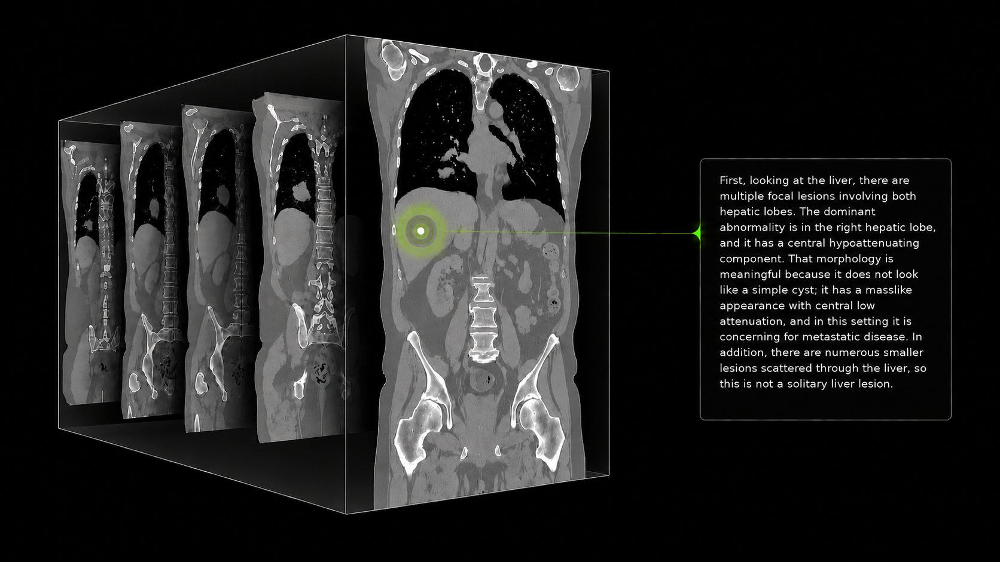

# NV-Reason-CT

[English](README.md) | **Español**

> Esta es una traducción del [README original en inglés](README.md). Si hay
> alguna discrepancia, la versión en inglés es la referencia.

[](https://huggingface.co/nvidia/NV-Reason-CT)
[](https://github.com/NVIDIA-Medtech/NV-Reason-CT)
[](https://huggingface.co/spaces/nvidia/nv-reason-ct)
[](https://arxiv.org/abs/2609.27511)
[](LICENSE)

NV-Reason-CT es un modelo generativo de visión y lenguaje para interpretar TC
de tórax y abdomen en 3D de forma nativa. Combina un modelo de lenguaje
Qwen3.5-4B con un Vision Transformer 3D (Primus, inicializado con los pesos de
COLIPRI) y permite clasificar anomalías, generar informes estructurados,
responder preguntas visuales (VQA) y razonar de forma interactiva a partir de
volúmenes NIfTI.

Este repositorio ofrece ejemplos de inferencia, de ajuste fino supervisado
(SFT) y de Group Relative Policy Optimization (GRPO) para el
[modelo NV-Reason-CT](https://huggingface.co/nvidia/NV-Reason-CT). El paquete
completo del modelo (pesos, código propio del modelo y del procesador,
configuración, tokenizer y metadatos de preprocesado) se mantiene en Hugging
Face y, a propósito, no se duplica aquí.

> NV-Reason-CT es solo para investigación y desarrollo. No es un producto
> sanitario y no debe usarse como sustituto del juicio clínico profesional, del
> diagnóstico ni de las decisiones de tratamiento. Las salidas del modelo
> pueden ser incorrectas y deben revisarlas profesionales médicos cualificados.

## Contenido

- [`inference.py`](inference.py): inferencia de un volumen desde la línea de comandos
- [`train/vlm_sft_train.py`](train/vlm_sft_train.py): ejemplo de SFT
- [`train/vlm_grpo_train.py`](train/vlm_grpo_train.py): punto de entrada de GRPO
- [`train/vlm_grpo_trainer.py`](train/vlm_grpo_trainer.py): adaptación a 3D del trainer GRPO de TRL
- [`train/vlm_rewards.py`](train/vlm_rewards.py): rewards verificables que tienen en cuenta la región
- [`datalists/`](datalists): registros de entrenamiento de ejemplo; los volúmenes de TC correspondientes no se incluyen
- [`examples/`](examples): tres volúmenes de TC de ejemplo guardados con Git LFS
- [`configs/`](configs): configuraciones de ejemplo de SFT y GRPO
- [`THIRD-PARTY-NOTICES`](THIRD-PARTY-NOTICES): dependencias de PyPI y licencias de los paquetes de terceros

## Origen del modelo

Todos los ejemplos cargan `nvidia/NV-Reason-CT` con
`AutoModelForImageTextToText` y `AutoProcessor`. Como el modelo define una
arquitectura 3D propia y un procesador de NIfTI propio, hace falta
`trust_remote_code=True`. La primera vez que se usa, Transformers descarga el
paquete del modelo desde Hugging Face y lo guarda en la caché local de Hugging
Face.

El ejemplo de inferencia por línea de comandos acepta `--model` cuando se
necesita una copia local del modelo u otro repositorio de Hugging Face. Las
configuraciones de entrenamiento usan `model_name_or_path: nvidia/NV-Reason-CT`
por defecto.

## Descripción del modelo

- Modelo de lenguaje base: [Qwen3.5-4B](https://huggingface.co/Qwen/Qwen3.5-4B)
- Codificador visual 3D: Primus, inicializado a partir de [COLIPRI](https://huggingface.co/microsoft/colipri)
- Entrada: TC de tórax o de abdomen de un solo canal en formato `.nii` o `.nii.gz`
- Preprocesado: orientación LPS, remuestreo isotrópico a 2 mm y un recorte de
  `192 x 192 x 192` vóxeles guiado por la anatomía
- Rejilla de parches: `24 x 24 x 24` a partir de parches de `8 x 8 x 8` sin solapamiento
- Interfaz visual: los 13.824 tokens visuales proyectados pasan al modelo de
  lenguaje sin fusión espacial
- Codificación posicional: la profundidad, la altura y la anchura se
  representan con MRoPE 3D

Los volúmenes de TC se envían a través del argumento propio `images3d=` del
procesador y de la torre 3D de Primus.



## Instalación

Se recomienda Python 3.11 y una instalación de PyTorch con soporte para CUDA.
Se puede crear un entorno nuevo con [`uv`](https://docs.astral.sh/uv/):

```bash
uv venv --seed --python 3.11 nvreasonct
source nvreasonct/bin/activate
```

Para inferencia:

```bash
uv pip install -r requirements.txt
```

Para entrenamiento:

```bash
uv pip install -r requirements-train.txt
uv pip install flash-attn==2.8.3 --no-build-isolation
```

El código y las configuraciones de entrenamiento están fijados a Transformers
5.6.2, TRL 1.2.0 y Accelerate 1.13.0, porque el trainer GRPO propio sigue el
funcionamiento interno de esas versiones de TRL.

## Inicio rápido: inferencia

La TC de entrada debe contener valores válidos en unidades Hounsfield.
Selecciona `"chest"` (tórax) o `"abdomen"` para que el procesador aplique el
recorte determinista correspondiente. Usa un estudio que contenga la anatomía
solicitada.

Los ejemplos siguientes usan `examples/example_1.nii.gz`, que contiene tórax y
abdomen. La región seleccionada determina qué anatomía se recorta.

### Descargar los volúmenes de ejemplo

Los tres volúmenes NIfTI de [`examples/`](examples) están guardados con Git
LFS. Instala [Git LFS](https://docs.github.com/en/repositories/working-with-files/managing-large-files/installing-git-large-file-storage)
y, después, ejecuta estos comandos desde la raíz del repositorio para
descargar los volúmenes reales:

```bash
git lfs install
git lfs pull --include="examples/*.nii.gz"
```

### Ejemplos por línea de comandos

Usa estos prompts para generar un informe estructurado de la región
seleccionada:

```bash
# Structured chest report
python inference.py examples/example_1.nii.gz --region chest \
  --prompt "write a structured chest CT report"

# Structured abdominal report
python inference.py examples/example_1.nii.gz --region abdomen \
  --prompt "write a structured abdominal CT report"
```

Estos también son los prompts por defecto cuando se omite `--prompt`. Para
pedir un razonamiento o hacer una pregunta concreta, cambia el prompt:

```bash
# Chest reasoning
python inference.py examples/example_1.nii.gz --region chest \
  --prompt "full chest CT reasoning analysis"

# Abdominal reasoning
python inference.py examples/example_1.nii.gz --region abdomen \
  --prompt "full abdominal CT reasoning analysis"

# Finding-specific question
python inference.py examples/example_1.nii.gz --region chest \
  --prompt "Which nodal regions contain lymphadenopathy?"
```

El modo de razonamiento (thinking) está activado por defecto. Para obtener una
respuesta concisa sin razonamiento:

```bash
python inference.py examples/example_1.nii.gz --region chest \
  --prompt "Is a pleural effusion present in this CT? Answer only Yes or No." \
  --disable-thinking
```

Cada comando de la CLI carga el modelo e inicia una conversación nueva. Para
hacer varias preguntas o mantener un diálogo de seguimiento, reutiliza el
modelo en Python como se muestra a continuación.

### Reutilizar el modelo en Python

Carga el modelo y el procesador una sola vez. `generate_response()` devuelve el
texto generado; si se le pasa una lista `history`, además añade a esa lista los
turnos del usuario y del asistente.

```python
import torch
from transformers import AutoModelForImageTextToText, AutoProcessor

model_id = "nvidia/NV-Reason-CT"
chest_path = "examples/example_1.nii.gz"
abdomen_path = "examples/example_1.nii.gz"

model = AutoModelForImageTextToText.from_pretrained(
    model_id,
    trust_remote_code=True,
    dtype=torch.bfloat16,
    attn_implementation="sdpa",
).eval().to("cuda")
processor = AutoProcessor.from_pretrained(model_id, trust_remote_code=True)


def generate_response(
    ct_path,
    prompt_text,
    anatomy_region="chest",
    enable_thinking=True,
    max_new_tokens=2048,
    history=None,
):
    """Generate a reply and append both turns to history when provided."""
    if history is None:
        history = []
    content = [{"type": "text", "text": prompt_text}]
    if not history:
        content.insert(0, {"type": "image"})
    history.append({"role": "user", "content": content})

    prompt = processor.apply_chat_template(
        history,
        tokenize=False,
        add_generation_prompt=True,
        enable_thinking=enable_thinking,
    )
    inputs = processor(
        text=prompt,
        images3d=[ct_path],
        anatomy_region=anatomy_region,
        return_tensors="pt",
    ).to(model.device)

    with torch.inference_mode():
        output_ids = model.generate(
            **inputs,
            max_new_tokens=max_new_tokens,
            do_sample=False,
            use_cache=True,
        )

    new_tokens = output_ids[:, inputs.input_ids.shape[1]:]
    response = processor.batch_decode(
        new_tokens,
        skip_special_tokens=True,
        clean_up_tokenization_spaces=False,
    )[0]
    history.append(
        {"role": "assistant", "content": [{"type": "text", "text": response}]}
    )
    return response
```

Estas peticiones independientes reutilizan el modelo ya cargado sin compartir
el historial de la conversación:

```python
# Structured reports
print(generate_response(chest_path, "write a structured chest CT report"))
print(generate_response(abdomen_path, "write a structured abdominal CT report", anatomy_region="abdomen"))

# Full reasoning
print(generate_response(chest_path, "full chest CT reasoning analysis"))
print(generate_response(abdomen_path, "full abdominal CT reasoning analysis", anatomy_region="abdomen"))
```

### Preguntas de seguimiento

Pasa la misma lista de historial para conservar las preguntas y respuestas
anteriores. Las preguntas siguientes tienen sentido cuando hay lesiones
hepáticas o se mencionan en el informe. Adapta las preguntas de cada caso a los
hallazgos reales.

```python
history = []
print(generate_response(abdomen_path, "write a structured abdominal CT report", anatomy_region="abdomen", history=history))
print(generate_response(abdomen_path, "Are the liver lesions solitary or multiple?", anatomy_region="abdomen", history=history))
print(generate_response(abdomen_path, "What is the most likely differential for the liver lesions?", anatomy_region="abdomen", history=history))
print(generate_response(abdomen_path, "which associated findings support it?", anatomy_region="abdomen", history=history))
```

Mantén la misma ruta de TC y la misma región anatómica durante toda la
conversación. Empieza con una lista de historial nueva y vacía para otro
estudio u otra región. El marcador de imagen solo se incluye en el primer turno
del usuario, mientras que el mismo volumen de TC se pasa en cada llamada.

Para continuar una conversación existente, proporciona mensajes alternos de
`user` y `assistant` con el mismo formato. Las respuestas del asistente de
abajo son ejemplos abreviados; sustitúyelas por las respuestas anteriores
reales de tu estudio:

```python
history = [
    {
        "role": "user",
        "content": [
            {"type": "image"},
            {"type": "text", "text": "write a structured abdominal CT report"},
        ],
    },
    {
        "role": "assistant",
        "content": [{"type": "text", "text": "Liver: Multiple hypoattenuating lesions in both hepatic lobes."}],
    },
    {
        "role": "user",
        "content": [{"type": "text", "text": "Are the liver lesions solitary or multiple?"}],
    },
    {
        "role": "assistant",
        "content": [{"type": "text", "text": "Multiple, with a dominant lesion in the right hepatic lobe."}],
    },
]

print(generate_response(
    abdomen_path,
    "What is the most likely differential for the liver lesions?",
    anatomy_region="abdomen",
    history=history,
))
```

Aquí, `history` termina con la respuesta anterior del asistente. La función
añade la nueva pregunta del usuario, genera una respuesta y la añade a
`history`. El marcador de imagen indica en qué punto de la conversación va la
TC; el volumen en sí se sigue pasando por separado mediante
`images3d=[ct_path]`.

## Inspeccionar el recorte que recibe el modelo

El mismo preprocesado que se usa en inferencia se puede inspeccionar sin
ejecutar el modelo:

```python
import nibabel as nib
import numpy as np
from transformers import AutoProcessor

processor = AutoProcessor.from_pretrained(
    "nvidia/NV-Reason-CT",
    trust_remote_code=True,
)
cropped = processor.image_processor_3d.load_image(
    "examples/example_1.nii.gz",
    normalize_mode=0,  # preserve Hounsfield units for inspection
    anatomy_region="chest",
)

affine = np.diag([-2.0, -2.0, 2.0, 1.0])
cropped_volume = cropped[0].permute(2, 1, 0).detach().cpu().numpy()
nib.save(nib.Nifti1Image(cropped_volume, affine), "crop.nii.gz")
```

El archivo de inspección tiene el tamaño de vóxel correcto de 2 mm y las
direcciones de los ejes LPS, pero `load_image()` no conserva el origen en
coordenadas del mundo del estudio original. Si la heurística anatómica no es
adecuada para un conjunto de datos, recorta el volumen antes de pasarlo al
modelo y llama al procesador con `anatomy_region=None` en tu propio código.

## Datos de entrenamiento de ejemplo

Los dos manifiestos contienen los mismos 128 ejemplos de informes estructurados
de tórax de CT-RATE y se proporcionan solo a modo ilustrativo.
`datalists/sft.jsonl` incluye las respuestas del asistente;
`datalists/grpo.jsonl` mantiene los mismos prompts y soluciones sin las
respuestas del asistente (GRPO no las necesita). Las imágenes no se incluyen.
Descarga los volúmenes de TC correspondientes de
[CT-RATE](https://huggingface.co/datasets/ibrahimhamamci/CT-RATE), siguiendo
sus instrucciones de acceso y las condiciones del dataset.

Cada fila de SFT contiene la conversación y repite la ruta del volumen en el
nivel superior para que el mismo registro sea fácil de adaptar a GRPO:

```json
{
  "id": "case-001",
  "image": "dataset/case-001.nii.gz",
  "anatomy_region": "chest",
  "solution": "Atelectasis, Pleural effusion",
  "messages": [
    {
      "role": "user",
      "content": [
        {"type": "image", "image": "dataset/case-001.nii.gz"},
        {"type": "text", "text": "Write a structured chest CT report."}
      ]
    },
    {
      "role": "assistant",
      "content": [
        {"type": "text", "text": "<think>...</think>\n...\n<answer>Atelectasis, Pleural effusion</answer>"}
      ]
    }
  ]
}
```

En GRPO, `messages` contiene solo el turno del usuario. `solution` es el
conjunto verificado de hallazgos, separados por comas, que usa la reward, y
`anatomy_region` selecciona la ontología de tórax o de abdomen que corresponda.
Las etiquetas permitidas se definen en
[`train/vlm_labels.py`](train/vlm_labels.py). Los casos sin hallazgos deben
usar exactamente `No Chest Finding` o `No Abdominal Finding`.

### Preparar las imágenes de TC

Ejecuta los ejemplos desde la raíz de este repositorio, con el entorno de
entrenamiento de [Instalación](#instalación) activado. El entrenamiento
resuelve las rutas relativas de las imágenes a partir de `--image_dir`;
apúntalo a la raíz de las rutas de tus archivos JSONL.

Proporciona archivos NIfTI de TC en unidades Hounsfield; el procesador se
encarga del remuestreo, del recorte anatómico y de la normalización.

Para tus propios datos, mantén el mismo esquema: las conversaciones de SFT
deben terminar con la respuesta del asistente de la que se aprende; los
ejemplos de GRPO contienen el prompt del usuario y las etiquetas verificadas de
`solution`. La solución de GRPO se usa para puntuar, no se añade al prompt del
modelo.

## Ejemplo de SFT

El collator de SFT calcula la loss solo sobre la última respuesta del
asistente, envía el volumen NIfTI a través de `images3d=` y respeta el
comportamiento multiturno del chat previsto por Qwen3.5. Por defecto, el
modelo de lenguaje, el codificador visual 3D y el proyector se entrenan de
extremo a extremo, partiendo de `nvidia/NV-Reason-CT`.

En un único nodo con ocho GPU CUDA, lanza una ejecución corta de ocho pasos:

```bash
accelerate launch --config_file accelerate/zero2.yaml \
  train/vlm_sft_train.py \
  --config configs/sft_config.yaml \
  --dataset_path datalists/sft.jsonl \
  --image_dir /path/to/ct-volumes \
  --output_dir data/nv_reason_ct_sft_example \
  --max_steps 8 \
  --logging_steps 1
```

La [configuración de SFT](configs/sft_config.yaml) usa un ejemplo por GPU y dos
pasos de acumulación de gradiente: 16 ejemplos por paso del optimizador entre
las ocho GPU. Ocho pasos recorren una vez el dataset de 128 ejemplos. Quita
`--max_steps` para usar el número de epochs configurado. Todos los componentes
entrenables comparten el learning rate configurado.

Observa en la consola `loss`, `grad_norm` y `learning_rate`. La loss debe
mantenerse finita, pero no tiene por qué bajar en cada paso. Esta ejecución
corta comprueba el pipeline de entrenamiento; no basta para establecer la
calidad del modelo. Las métricas también se guardan en el directorio de
salida, entre ellas `trainer_state.json` y `train_results.json`. W&B no es
necesario (`report_to: none`).

Usa `--freeze_llm`, `--freeze_visual` o `--freeze_merger` para experimentos de
adaptación controlados.

## Ejemplo de GRPO

GRPO muestrea varias respuestas para un mismo prompt y aprende de sus rewards
relativas en lugar de una respuesta de referencia del asistente. Este ejemplo
usa informes estructurados que terminan con un único bloque
`<answer>...</answer>` de etiquetas de hallazgos y combina tres rewards:

```text
2.0 * abnormality-set F1
+ 0.5 * region-specific report-structure score
+ 1.0 * soft completion-length penalty
```

Es decir: 2,0 × F1 del conjunto de anomalías, más 0,5 × puntuación de la
estructura del informe según la región, más 1,0 × una penalización suave por
la longitud de la respuesta.

Por defecto, GRPO parte de forma independiente de `nvidia/NV-Reason-CT` y
entrena de extremo a extremo el modelo de lenguaje, el codificador visual 3D y
el proyector. Con la misma configuración de ocho GPU, ejecuta seis pasos, que
incluyen los cinco pasos de warmup configurados y un paso después del warmup:

```bash
accelerate launch --config_file accelerate/zero2.yaml \
  train/vlm_grpo_train.py \
  --config configs/grpo_config.yaml \
  --dataset_path datalists/grpo.jsonl \
  --image_dir /path/to/ct-volumes \
  --output_dir data/nv_reason_ct_grpo_example \
  --max_steps 6
```

La [configuración de GRPO](configs/grpo_config.yaml) genera 16 respuestas por
prompt. Mantén los ajustes de batch y de acumulación para ocho GPU que vienen
con este ejemplo; si los cambias, el batch de generación debe seguir siendo
divisible por `num_generations`. Quita `--max_steps` para ejecutar las epochs
configuradas.

Observa la `reward` total, las métricas de cada reward y `reward_std`, además
de la loss. La loss de GRPO no es directamente comparable con la de SFT. Los
grupos en los que todas las respuestas reciben la misma reward no aportan
señal de aprendizaje relativa. La generación hace que cada paso de GRPO sea
más lento que uno de SFT, y una ejecución de seis pasos solo sirve para
comprobar el pipeline. Estas rewards son específicas de la tarea de informes
estructurados; otras tareas de QA pueden necesitar rewards distintas.

### Continuar desde un checkpoint de SFT

Para usar el modelo guardado por el ejemplo de SFT en lugar del checkpoint
publicado, cambia `--model_name_or_path` y usa otro directorio de salida:

```bash
accelerate launch --config_file accelerate/zero2.yaml \
  train/vlm_grpo_train.py \
  --config configs/grpo_config.yaml \
  --model_name_or_path data/nv_reason_ct_sft_example \
  --dataset_path datalists/grpo.jsonl \
  --image_dir /path/to/ct-volumes \
  --output_dir data/nv_reason_ct_sft_grpo_example \
  --max_steps 6
```

Por ahora, el trainer propio usa la generación estándar de Transformers en
lugar de vLLM, porque el tensor de TC 5D y la ruta `images3d=` requieren un
tratamiento especial.

Las configuraciones proporcionadas son ejemplos de entrenamiento en un único
nodo. Adáptalas a tus propios datos y a tu hardware.

## Usar el modelo entrenado

Los dos scripts de entrenamiento guardan el modelo final y el procesador
directamente en `--output_dir`. Carga ese directorio con el mismo script de
inferencia:

```bash
python inference.py examples/example_1.nii.gz \
  --model data/nv_reason_ct_sft_example \
  --region chest
```

Sustituye la ruta de la TC por uno de tus estudios. Para probar un modelo
entrenado con GRPO, usa su directorio de salida en `--model`. Se aplican las
mismas opciones de `--prompt` que aparecen en
[Inicio rápido: inferencia](#inicio-rápido-inferencia). En los ejemplos de
Python, asigna a `model_id` el directorio de salida para cargar tanto el
modelo como el procesador, también en la inferencia multiturno.

Usa un directorio de salida nuevo para cada experimento desde cero. Si existe
un subdirectorio `checkpoint-*`, volver a lanzar el mismo comando de
entrenamiento reanuda automáticamente desde el más reciente, incluido el
estado del optimizador y del scheduler. Para continuar una ejecución
interrumpida, mantén su configuración y su directorio de salida originales.
Cargar el modelo final mediante `--model_name_or_path` en un directorio de
salida nuevo inicia un entrenamiento nuevo en lugar de restaurar ese estado de
entrenamiento.

## Agradecimientos

Este proyecto lo ha llevado a cabo NVIDIA en colaboración con el National
Cancer Institute de los NIH y la Universidad de Zúrich. NV-Reason-CT se basa en
[Qwen3.5](https://huggingface.co/Qwen/Qwen3.5-4B),
[Primus](https://openreview.net/forum?id=x4vZE4PDEu),
[COLIPRI](https://arxiv.org/abs/2510.15042),
[MONAI](https://monai.io/),
[Transformers](https://github.com/huggingface/transformers) y
[TRL](https://github.com/huggingface/trl). Amplía la estrategia de
entrenamiento centrada en el razonamiento que se presentó en
[NV-Reason-CXR](https://github.com/NVIDIA-Medtech/NV-Reason-CXR).


## Licencia

Este repositorio se publica bajo la [licencia OpenMDW-1.1](LICENSE), la misma
que usa el
[repositorio del modelo en Hugging Face](https://huggingface.co/nvidia/NV-Reason-CT).
Las licencias de los paquetes de terceros se enumeran en
[THIRD-PARTY-NOTICES](THIRD-PARTY-NOTICES).

## Cita

Este repositorio acompaña al artículo [NV-Reason-CT: 3D Visual Language Model
for CT Analysis](https://arxiv.org/abs/2609.27511).
